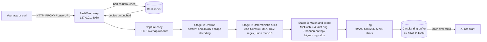

<div align="center">

# NullWire-MCP

**See the traffic. Never the secrets.**

[](https://github.com/VoxNode-ux/nullwire-mcp/actions/workflows/release.yml)
[](https://github.com/VoxNode-ux/nullwire-mcp/actions/workflows/security.yml)
[](https://github.com/VoxNode-ux/nullwire-mcp/actions/workflows/quality.yml)
[](https://codecov.io/gh/VoxNode-ux/nullwire-mcp)


 
<!--[OpenSSF Scorecard](https://api.scorecard.dev/projects/github.com/VoxNode-ux/nullwire-mcp/badge)-->

[Quick start](#quick-start) · [Salted tags](#what-the-model-sees) · [How it works](#how-it-works) · [Honest limits](#honest-limits) · [Docs](#documentation)

[Try the live redactor](https://voxnode-ux.github.io/nullwire-mcp/) (the real engine, running in your browser; nothing is uploaded)

</div>

NullWire is a local inspector for HTTP, HTTPS and WebSocket traffic, built so an AI assistant can help debug it. It records traffic as it passes through, removes secrets from the recorded copy, and serves that copy over the [Model Context Protocol](https://modelcontextprotocol.io). It is one static Go binary with no dependencies, and it keeps the last 50 flows in RAM only.

## The problem

Debugging an API call with an assistant means showing it the request, and the request carries an `Authorization` header, a session cookie, a database URL or a customer's email. Pasting raw traffic into a chat pastes those with it.

NullWire sits between your app and the network instead. Your app talks to the real server and its bodies are never rewritten. The assistant only ever reads the scrubbed copy.

```text
  your app ──► NullWire (127.0.0.1) ──► the real server
                    │
                    ├─ forwards your traffic as-is (bodies untouched)
                    └─ keeps a scrubbed copy in RAM ──► your AI assistant (MCP)
```

## Quick start

```bash
# Node (also registers NullWire with your MCP clients)
npx -y nullwire-mcp install --client all

# macOS and Linux, Homebrew
brew install VoxNode-ux/nullwire/nullwire-mcp

# Linux and macOS, one line; --setup also registers your MCP clients
curl -fsSL https://raw.githubusercontent.com/VoxNode-ux/nullwire-mcp/main/scripts/install.sh | sh -s -- --setup
```

With Homebrew, run `nullwire-mcp install --client all` afterwards. Restart your MCP client, then send some traffic through the proxy:

```bash
# Plain HTTP through the proxy
curl -x http://127.0.0.1:8080 http://httpbin.org/headers

# HTTPS with full request visibility: the reverse gateway
nullwire-mcp -target https://api.example.com
curl http://127.0.0.1:8080/v1/things -H "Authorization: Bearer sk-live-..."
```

Then ask your assistant: *"Use `inspect_traffic` to show my last 5 requests and tell me why the third one returned 401."*

Windows, Docker, Termux, Scoop, winget, Nix and the other install methods are in [docs/install.md](docs/install.md).

## What the model sees

Every secret is replaced by a salted tag. This is a captured flow as the assistant receives it (illustrative):

```json
{
  "id": 7,
  "method": "POST",
  "url": "https://api.example.com/v1/charge",
  "request_headers": { "Authorization": "[REDACTED_TOKEN#a1b2c3]", "Content-Type": "application/json" },
  "request_body": "{\"card_token\":\"[REDACTED_TOKEN#9f3e21]\",\"amount\":4200}",
  "status_code": 401,
  "response_body": "{\"error\":\"invalid_api_key\"}",
  "redaction_count": 2
}
```

The tag is the first 6 hex characters of an HMAC-SHA256 of the secret, keyed with an ephemeral 256-bit `crypto/rand` key that lives in RAM only. The same secret gets the same tag for the whole run, so the assistant can see that two requests used the same token without learning it. The key changes on every start, so tags cannot be compared across restarts or reversed. Tag kinds are `TOKEN`, `COOKIE`, `IP`, `KEY` and `PAN`.

## How it works



The three stages and the twelve layers are in [docs/redaction.md](docs/redaction.md). The main techniques, by name:

- **Aho-Corasick DFA:** an O(n) automaton with 256-byte alphabet compression decides which rules run, so most text never touches a regular expression. Rules themselves are RE2 regular expressions, which run in linear time.
- **Shannon entropy, sliding window:** a 24-byte window scores a long run by its most random stretch, to catch keys nobody has seen before.
- **First-order Markov bigram log-likelihood:** an int8 character-pair matrix measures how much a run looks like natural text or code. It is trained by an additive-smoothed log-likelihood ratio.
- **Additive log-odds score:** window entropy, bigram evidence, vowel ratio and length combine into one score; above zero means secret.
- **Luhn mod-10:** payment card numbers need a known network prefix, a valid length and a valid checksum. Decoded base64 must also pass a control-byte ratio check.
- **SipHash-2-4 taint ring:** a 500-slot keyed hash ring with 24-byte shingles redacts a secret seen once by identity wherever it reappears, even cut or embedded. Only hashes are kept.
- **HMAC-SHA256:** keyed tags, as described above.
- **Bounded memory:** an O(1) 50-flow circular ring buffer, an 8 KiB overlap window captured before truncation, and a zip-bomb shield with size and entry limits.
- **WebSocket unmasking:** client-to-server frames are unmasked with a periodic XOR of the 4-byte key (`index & 3`) on a read-only copy; the forwarded frames are untouched.

Where each one lives in the code is in [docs/architecture.md](docs/architecture.md).

## Honest limits

- It is not a TLS interceptor. `CONNECT` tunnels show only the destination and byte counts; use the reverse gateway for HTTPS content.
- Redaction is pattern and heuristic based. A secret in an unanticipated shape that is also low in randomness can slip through, and the detector can redact a harmless long identifier. Add your own patterns in the config.
- A secret made only of decimal digits is not caught by the randomness detector. It is still redacted under a secret-looking field name or in a secret header.
- Brotli and Zstd bodies are never decoded: requests are refused and responses are flagged.
- Binary protobuf and gRPC bodies are not captured. WebSocket flows appear when the connection closes.
- Release binaries carry signed build provenance, not OS-vendor code-signing certificates. Verify them with `SHA256SUMS.txt` and `gh attestation verify`.

The full list and the safety shields are in [docs/security.md](docs/security.md).

## Documentation

| Document | Contents |
|---|---|
| [docs/install.md](docs/install.md) | Every install method, MCP client setup, platform notes |
| [docs/cli.md](docs/cli.md) | CLI flags, capture modes, MCP tools, configuration, `scan` and `protect`, troubleshooting |
| [docs/redaction.md](docs/redaction.md) | The three stages, the twelve layers, recent changes |
| [docs/security.md](docs/security.md) | Security model, safety shields, tested platforms |
| [docs/architecture.md](docs/architecture.md) | Algorithms, project layout, development |
| [docs/comparison.md](docs/comparison.md) | How it compares to other tools |

Contributions are welcome; see [CONTRIBUTING.md](CONTRIBUTING.md).

---

Built by [VoxNode-ux](https://github.com/VoxNode-ux) · Version 1.2.0 · License: see the repository's `LICENSE` file


**If NullWire saved you from pasting a secret into a chat, a ⭐ helps others find it.**