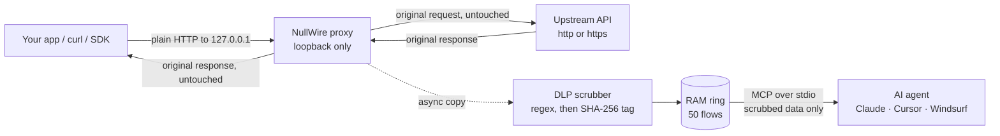

<div align="center">

# ⚡ NullWire-MCP

### Your AI agent can debug live HTTP traffic.<br>It never sees a single secret.

Every token, cookie and IP is swapped for a **salted tag that stays the same for the whole session**, so the agent can still tell<br>
*"same token reused"* from *"token rotated"*: the question behind most auth bugs.

[](https://github.com/VoxNode-ux/nullwire-mcp/actions/workflows/release.yml)
[](https://github.com/VoxNode-ux/nullwire-mcp/releases)

-brightgreen)
-brightgreen)

[](LICENSE)

[**Quick start**](#quick-start) ·
[**How it works**](#how-it-works) ·
[**Install**](#install) ·
[**Tools**](#tools) ·
[**Security**](#security) ·
[**Limitations**](#limitations) ·
[**FAQ**](#faq)

</div>

<!-- Tip: record a 10-15s terminal GIF (curl with a secret, then the agent's view) and place it here:
<p align="center"></p> -->

---

## 👀 See the difference

```text
 You send        Authorization: Bearer sk-live-51Hk3...
 Your AI sees    Authorization: Bearer [REDACTED_TOKEN#a1b2c3]

 Request #1      Bearer [REDACTED_TOKEN#a1b2c3]
 Request #2      Bearer [REDACTED_TOKEN#a1b2c3]   ◄── same token, reused ✔
 Request #3      Bearer [REDACTED_TOKEN#7f09de]   ◄── different token, it rotated ✔
```

Blind `[REDACTED]` protects you but makes the AI useless for auth bugs. NullWire keeps the *identity* of each secret and throws away the *value*.

| 📦 **0** dependencies | 💾 **0** bytes written to disk | 🔍 **1** source file to audit | 🖥️ **9** release targets |
|:---:|:---:|:---:|:---:|
| pure Go stdlib | RAM-only 50-flow ring | `main.go` | Linux · macOS · Windows · FreeBSD |

---

<a id="quick-start"></a>

## ⚡ Quick start in 60 seconds

```bash
# 1. install (Go 1.26+), or grab a prebuilt binary from Releases
go install github.com/VoxNode-ux/nullwire-mcp@latest

# 2. register it with your AI client (Claude Code shown; Cursor/Windsurf/Desktop configs below)
claude mcp add nullwire -- nullwire-mcp -port 8080 -target https://api.example.com

# 3. point your app at the proxy instead of the real API
curl http://127.0.0.1:8080/v1/orders -H "Authorization: Bearer $MY_TOKEN"
```

Then just ask your agent:

> *"Why is `/v1/orders` returning 401? Compare the auth headers of the last 5 requests."*
> *"Did request 3 and 4 use the same token, or did it rotate?"*
> *"Give me a curl to replay the failing call."*

Your app always gets the **real, untouched response**. Only the agent's view is scrubbed.

---

## 🔥 Why this exists

Point an AI agent at your network traffic and a typical capture proxy hands it **everything**: live bearer tokens, session cookies, internal IPs. All of it lands in a cloud LLM context window, and often in a capture file left on disk.

Blind `[REDACTED]` stops the leak but kills the debugging. NullWire-MCP redacts every secret **in RAM** and swaps it for a **deterministic, per-process salted tag**: the agent keeps the *identity* of each secret and never sees the *value*.

> The tag is `SHA-256(nonce ‖ secret)[:6]`. The `nonce` is 32 random bytes drawn from `crypto/rand` at startup, kept **only in RAM**, and gone when the process exits. See the [security deep-dive](#security) for why that matters.

---

<a id="how-it-works"></a>

## 🧭 How it works



Two paths, one rule: **the real bytes go to your app, only a scrubbed copy goes to the AI.** Nothing touches the disk.

<details>
<summary><b>Diagram not rendering (mobile, Mermaid disabled)? Open the ASCII version</b></summary>

1. Your app or CLI sends plain HTTP traffic to the local loopback proxy at 127.0.0.1:8080.
2. The proxy forwards the original bytes untouched to the upstream API while an async copy is scrubbed in RAM.
3. Your AI agent inspects the sanitized flows over JSON-RPC stdio without ever seeing live tokens or secrets.

```text

╔══ [1] LOCAL APP / CLI ══════════════════════════════════════╗
║ curl · SDK · browser · your service                         ║▒
║ speaks plain HTTP to 127.0.0.1:8080                         ║▒
╚═════════════════════════════════════════════════════════════╝▒
 ▒▒▒▒▒▒▒▒▒▒▒▒▒▒▒▒▒▒▒▒▒▒▒▒▒▒▒▒▒▒▒▒▒▒▒▒▒▒▒▒▒▒▒▒▒▒▒▒▒▒▒▒▒▒▒▒▒▒▒▒▒▒▒
                               │
                               ▼  plain HTTP, loopback only
╔══ [2] NULLWIRE PROXY  127.0.0.1:8080 ═══════════════════════╗
║ bound with net.Listen(tcp4) + IsLoopback() check            ║▒
║ forward mode : absolute URL  (curl -x)                      ║▒
║ reverse mode : -target flag / X-Target-URL header           ║▒
║ guards : DNS-rebind 403 · self-loop 508 · 256 tunnel cap    ║▒
╚═════════════════════════════════════════════════════════════╝▒
 ▒▒▒▒▒▒▒▒▒▒▒▒▒▒▒▒▒▒▒▒▒▒▒▒▒▒▒▒▒▒▒▒▒▒▒▒▒▒▒▒▒▒▒▒▒▒▒▒▒▒▒▒▒▒▒▒▒▒▒▒▒▒▒
                               │
                               ▼  io.TeeReader split
               ┌───────────────┴────────────────┐
               ▼                                ▼
╔══ [3a] ROUNDTRIP ══════════╗   ╔══ [3b] DLP SCRUBBER ═══════╗
║ http.Transport (isolated)  ║▒  ║ async copy, capped at 64KB ║▒
║ Accept-Encoding stripped   ║▒  ║ regex scrub, THEN truncate ║▒
║ Host = upstream host       ║▒  ║ SHA-256(nonce|secret)[:6]  ║▒
║ bytes forwarded untouched  ║▒  ║ 32-byte crypto/rand nonce  ║▒
╚════════════════════════════╝▒  ╚════════════════════════════╝▒
 ▒▒▒▒▒▒▒▒▒▒▒▒▒▒▒▒▒▒▒▒▒▒▒▒▒▒▒▒▒▒   ▒▒▒▒▒▒▒▒▒▒▒▒▒▒▒▒▒▒▒▒▒▒▒▒▒▒▒▒▒▒
               │                                │
               ▼                                ▼
┌── UPSTREAM API ────────────┐   ╔══ [4] RAM RING ════════════╗
│ http:// or https://        │▒  ║ 50 slots · sync.RWMutex    ║▒
│ TLS handled by Go, no MITM │▒  ║ req 8KB / resp 16KB max    ║▒
└────────────────────────────┘▒  ║ newest-first reads         ║▒
 ▒▒▒▒▒▒▒▒▒▒▒▒▒▒▒▒▒▒▒▒▒▒▒▒▒▒▒▒▒▒  ║ disk writes: none          ║▒
               │                 ╚════════════════════════════╝▒
◄──┘ original response            ▒▒▒▒▒▒▒▒▒▒▒▒▒▒▒▒▒▒▒▒▒▒▒▒▒▒▒▒▒▒
    returns to the app                          │
                                                ▼
╔══ [5] JSON-RPC 2.0 MCP (2026-07-28 + legacy) ═══════════════╗
║ initialize · discover · ping · tools/list · call            ║▒
║ inspect_traffic · export_sanitized_curl · clear_ram_buffer  ║▒
║ notifications → zero bytes written                          ║▒
╚═════════════════════════════════════════════════════════════╝▒
 ▒▒▒▒▒▒▒▒▒▒▒▒▒▒▒▒▒▒▒▒▒▒▒▒▒▒▒▒▒▒▒▒▒▒▒▒▒▒▒▒▒▒▒▒▒▒▒▒▒▒▒▒▒▒▒▒▒▒▒▒▒▒▒
               │                                │
               ▼                                ▼
╔══ STDOUT ▓▓▓ ══════════════╗   ┌── STDERR ░░░ ──────────────┐
║ one compact JSON line      ║▒  │ ANSI status bar,           │▒
║ per frame, ends in \n      ║▒  │ banners, errors            │▒
║ NOTHING else, ever         ║▒  │ (human telemetry)          │▒
╚════════════════════════════╝▒  └────────────────────────────┘▒
 ▒▒▒▒▒▒▒▒▒▒▒▒▒▒▒▒▒▒▒▒▒▒▒▒▒▒▒▒▒▒   ▒▒▒▒▒▒▒▒▒▒▒▒▒▒▒▒▒▒▒▒▒▒▒▒▒▒▒▒▒▒
               │                                │
               ▼                                ▼
╔══ AI AGENT (MCP) ══════════╗   ┌── HUMAN ───────────────────┐
║ Claude Code · Desktop      ║▒  │ you, in a terminal         │▒
║ Cursor · Windsurf          ║▒  └────────────────────────────┘▒
╚════════════════════════════╝▒   ▒▒▒▒▒▒▒▒▒▒▒▒▒▒▒▒▒▒▒▒▒▒▒▒▒▒▒▒▒▒
 ▒▒▒▒▒▒▒▒▒▒▒▒▒▒▒▒▒▒▒▒▒▒▒▒▒▒▒▒▒▒
```

**Your app always gets the real, untouched response.** Only the AI agent's view is scrubbed.

The live telemetry bar on `stderr` (redrawn in place with `\r\033[K`):

```text
⚡ [NullWire-MCP] Proxy 127.0.0.1:8080 | RAM Ring: 14/50 | Scrubbed: 9 Tokens, 4 Cookies, 6 IPs | Disk: 0B
```

</details>

## 📊 NullWire-MCP vs. traditional MITM MCP wrappers

| | **⚡ NullWire-MCP** | Typical MITM-based MCP wrapper |
|---|---|---|
| **Third-party dependencies** | **0** (Go standard library only; `go.mod` has no `require`) | Dozens of transitive Python / Node / JVM packages |
| **Disk footprint** | **0 B**, RAM-only 50-slot ring; the code contains no file I/O | Flow files / SQLite databases on disk |
| **Secret redaction** | **Salted SHA-256 correlation tags**, so reuse is provable and the secret is unseen | Often none, or blind `[REDACTED]` that destroys correlation |
| **Startup** | Native static binary: no interpreter, no VM, no package resolution | Interpreter / VM cold start |
| **MCP protocol** | **2026-07-28 stateless + 2025-11-25 / 2024-11-05 legacy** | Varies by tool |
| **HTTPS upstreams** | Reverse gateway: no root CA, no keychain changes | Install a root CA and intercept TLS |
| **Supply chain to audit** | One `main.go` | The whole dependency tree |

<sub>The right-hand column describes the general class of tools that capture traffic with a MITM proxy and hand it to an LLM. It is not a claim about any specific product. We have not published startup benchmarks; the startup row is architectural.</sub>

---

<a id="install"></a>

## 🚀 30-second install

**Option A: `go install`** (Go 1.26+)

```bash
go install github.com/VoxNode-ux/nullwire-mcp@latest
```

**Option B: prebuilt static binary**, verified against `SHA256SUMS.txt` and signed GitHub build provenance from [GitHub Releases](https://github.com/VoxNode-ux/nullwire-mcp/releases) (each release also includes a CycloneDX SBOM `nullwire-sbom.cdx.json`):

| Platform | File |
|---|---|
| Linux x86-64 / ARM64 | `nullwire-linux-amd64` / `nullwire-linux-arm64` |
| Linux ARMv7 (Raspberry Pi etc.) / RISC-V 64 | `nullwire-linux-armv7` / `nullwire-linux-riscv64` |
| macOS Intel / Apple Silicon | `nullwire-darwin-amd64` / `nullwire-darwin-arm64` |
| Windows x86-64 / ARM64 | `nullwire-windows-amd64.exe` / `nullwire-windows-arm64.exe` |
| FreeBSD x86-64 | `nullwire-freebsd-amd64` |

```bash
# Linux example (swap the file name for your platform)
BASE=https://github.com/VoxNode-ux/nullwire-mcp/releases/latest/download
curl -LO "$BASE/nullwire-linux-amd64"
curl -LO "$BASE/SHA256SUMS.txt"
grep ' nullwire-linux-amd64$' SHA256SUMS.txt | sha256sum -c -     # macOS: shasum -a 256 -c -
gh attestation verify nullwire-linux-amd64 --repo VoxNode-ux/nullwire-mcp  # optional: verify signed build provenance
chmod +x nullwire-linux-amd64
sudo mv nullwire-linux-amd64 /usr/local/bin/nullwire-mcp
```

```powershell
# Windows (PowerShell)
Get-FileHash .\nullwire-windows-amd64.exe -Algorithm SHA256   # compare with SHA256SUMS.txt
```

**Option C: build from source**

```bash
git clone https://github.com/VoxNode-ux/nullwire-mcp && cd nullwire-mcp
CGO_ENABLED=0 go build -trimpath -ldflags="-s -w" -o nullwire-mcp .
```

### Flags

| Flag | Default | Meaning |
|---|---|---|
| `-port` | `8080` | Loopback port. The host is hard-coded to `127.0.0.1`; there is no way to bind elsewhere. `0` picks a free port. |
| `-target` | *(none)* | Default upstream base URL for reverse-gateway mode, e.g. `https://api.example.com` |
| `-dns` | `auto` | Upstream DNS. `auto` uses the system resolver, except on Termux/Android where it uses `1.1.1.1` and `9.9.9.9` (static binaries have no resolver config there). `system` always uses the system resolver. A comma list of IPs, e.g. `-dns 192.168.1.1,9.9.9.9:53`, uses exactly those servers. |

### Try it without an AI client

The MCP side lives as long as stdin stays open, so for a quick demo feed it a request on a timer:

```bash
( sleep 2
  echo '{"jsonrpc":"2.0","id":1,"method":"tools/call","params":{"name":"inspect_traffic","arguments":{"limit":5}}}'
  sleep 1 ) | nullwire-mcp -port 8080 &

sleep 1
curl -s -x http://127.0.0.1:8080 http://example.com \
  -H 'Authorization: Bearer my_secret_token_123' \
  -H 'Cookie: sid=my_secret_cookie' \
  -H 'X-Forwarded-For: 198.51.100.1' > /dev/null
wait
```

You'll see the live status bar on stderr and, on stdout, a flow whose headers read `Bearer [REDACTED_TOKEN#…]`, `[REDACTED_COOKIE#…]` and `[REDACTED_IP#…]`.

### Plug it into your AI client

The client launches `nullwire-mcp` as a subprocess and talks JSON-RPC over stdio. Your app then sends its traffic to `127.0.0.1:8080`. (Config file locations change between client releases, so check your client's docs if a path below is out of date.)

**Claude Code CLI**

```bash
claude mcp add nullwire -- nullwire-mcp -port 8080 -target https://api.example.com
```

**Claude Desktop** (`claude_desktop_config.json`)

```json
{
  "mcpServers": {
    "nullwire": {
      "command": "nullwire-mcp",
      "args": ["-port", "8080", "-target", "https://api.example.com"]
    }
  }
}
```

**Cursor** (`~/.cursor/mcp.json`, or `.cursor/mcp.json` in a project)

```json
{
  "mcpServers": {
    "nullwire": {
      "command": "nullwire-mcp",
      "args": ["-port", "8080", "-target", "https://api.example.com"]
    }
  }
}
```

**Windsurf** (`~/.codeium/windsurf/mcp_config.json`)

```json
{
  "mcpServers": {
    "nullwire": {
      "command": "nullwire-mcp",
      "args": ["-port", "8080", "-target", "https://api.example.com"]
    }
  }
}
```

Omit `-target` if you only use forward-proxy mode or the per-request `X-Target-URL` header.


---

## 🔀 Two capture modes

### Mode 1: Forward proxy (plain HTTP)

Send a full URL through the proxy. The request is forwarded as-is and a scrubbed copy lands in the ring.

```bash
curl -x http://127.0.0.1:8080 http://httpbin.org/headers

# or for any app that honours the standard variable
HTTP_PROXY=http://127.0.0.1:8080 ./my-service
```

> `HTTPS_PROXY` makes clients send `CONNECT`. NullWire answers with a **blind TCP tunnel**: the connection works, but the TLS payload is never decrypted, read or stored. The flow appears in the ring as a `CONNECT` entry with the target and byte counts only. To see HTTPS *requests*, use Mode 2. See [Honest scope](#limitations).

<a id="mode-2"></a>

### Mode 2: Reverse gateway (HTTPS upstreams, no MITM certificates)

Talk plain HTTP to NullWire; NullWire speaks TLS to the real server using Go's normal certificate verification. Nothing to install in your trust store.

```bash
# Fixed upstream for the whole session
nullwire-mcp -target https://api.github.com
curl http://127.0.0.1:8080/users/octocat

# Or choose the upstream per request (the header is removed before forwarding)
curl -H 'X-Target-URL: https://httpbin.org' 'http://127.0.0.1:8080/anything?api_key=hunter2hunter2'
```

Point an SDK at it by changing only its base URL:

```bash
export OPENAI_BASE_URL=http://127.0.0.1:8080/v1   # with: nullwire-mcp -target https://api.openai.com
```

The upstream `Host` header is set to the target's host, so virtual hosting and TLS SNI behave normally.


---

<a id="tools"></a>

## 🧰 MCP tool reference

All three tools return `{"resultType":"complete","content":[{"type":"text","text":"…"}],"isError":false}`. Tool-level problems (for example an unknown flow id) set `isError` to `true` instead of failing the RPC.

### `inspect_traffic`

Recent scrubbed flows, newest first.

```json
{
  "name": "inspect_traffic",
  "inputSchema": {
    "type": "object",
    "properties": {
      "limit":      { "type": "integer", "default": 10, "minimum": 1, "maximum": 50 },
      "method":     { "type": "string",  "description": "HTTP method filter, case-insensitive" },
      "url_filter": { "type": "string",  "description": "Substring of the scrubbed URL, case-insensitive" }
    },
    "additionalProperties": false
  }
}
```

Example result text:

```json
{
  "ring_size": 3,
  "ring_capacity": 50,
  "returned": 1,
  "scrubbed_totals": { "tokens": 5, "cookies": 1, "ips": 1 },
  "flows": [
    {
      "id": 3,
      "timestamp": "2026-10-25T14:03:11Z",
      "method": "POST",
      "url": "http://[REDACTED_IP#98f1a2]:9000/v1/orders?api_key=[REDACTED_TOKEN#3c9a1e]",
      "request_headers": {
        "Authorization": "Bearer [REDACTED_TOKEN#a1b2c3]",
        "Content-Type": "application/json",
        "Cookie": "[REDACTED_COOKIE#d4e5f6]"
      },
      "request_body": "{\"item\":\"widget\",\"client_secret\":\"[REDACTED_TOKEN#5b7e20]\"}",
      "status_code": 401,
      "response_headers": { "Content-Type": "application/json" },
      "response_body": "{\"error\":\"token expired\"}",
      "latency_ms": 42,
      "redaction_count": 5
    }
  ]
}
```

### `export_sanitized_curl`

Rebuilds a runnable POSIX `curl` command for one flow. Every redaction tag becomes an environment-variable placeholder, and a comment legend maps each placeholder back to the tag it replaced, so you can tell which real value belongs where.

```json
{
  "name": "export_sanitized_curl",
  "inputSchema": {
    "type": "object",
    "properties": {
      "flow_id": { "type": "integer", "minimum": 1, "description": "An id returned by inspect_traffic" }
    },
    "required": ["flow_id"],
    "additionalProperties": false
  }
}
```

Example result text for flow `3` above:

```bash
# Replay of flow 3 (2026-10-25T14:03:11Z)
# Set these environment variables first (distinct tags share one placeholder):
# export NULLWIRE_IP=...   # was [REDACTED_IP#98f1a2]
# export NULLWIRE_AUTH_TOKEN=...   # was [REDACTED_TOKEN#3c9a1e]
# export NULLWIRE_AUTH_TOKEN=...   # was [REDACTED_TOKEN#5b7e20]
# export NULLWIRE_AUTH_TOKEN=...   # was [REDACTED_TOKEN#a1b2c3]
# export NULLWIRE_COOKIE=...   # was [REDACTED_COOKIE#d4e5f6]
curl -X 'POST' 'http://'"$NULLWIRE_IP"':9000/v1/orders?api_key='"$NULLWIRE_AUTH_TOKEN" \
  -H 'Authorization: Bearer '"$NULLWIRE_AUTH_TOKEN" \
  -H 'Content-Type: application/json' \
  -H 'Cookie: '"$NULLWIRE_COOKIE" \
  --data-raw '{"item":"widget","client_secret":"'"$NULLWIRE_AUTH_TOKEN"'"}'
```

Hop-by-hop headers, `Host`, `Content-Length` and `Accept-Encoding` are left out so `curl` can set them itself. Truncated or encoded request bodies get a `# WARNING:` line instead of silently replaying something incomplete.

### `clear_ram_buffer`

Zeroes all 50 slots and resets the scrub counters. Flow ids keep counting upward, so an old id can never point at a new flow. Takes no arguments (`{"type":"object","properties":{},"additionalProperties":false}`).


---

> **Every release is built with Go 1.26** and includes SHA256 checksums and a signed build provenance attestation you can verify with `gh attestation verify`. The same proof is also attached to each release as `nullwire-provenance.intoto.jsonl`.

<a id="security"></a>

## 🛡️ Security & protocol engineering deep-dive

Every item below is implemented in `main.go` and exercised by `main_test.go` and `fuzz_test.go`.

| Measure | What it does | Why |
|---|---|---|
| **Strict loopback bind** | The listener address is hard-coded `127.0.0.1`, opened with `net.Listen("tcp4", …)`, then re-checked with `TCPAddr.IP.IsLoopback()`. The process exits if the check fails. There is no `-host` flag. | Nothing on your LAN can reach a proxy that sees your tokens. |
| **DNS-rebinding guard** | In reverse mode, any request whose `Host` header is not `127.0.0.1`, `localhost` or `::1` gets `403 Forbidden`. | A malicious web page that rebinds its domain to `127.0.0.1` can't use your gateway as an authenticated relay. |
| **Self-loop protection** | A target that resolves to the proxy's own `host:port` gets `508 Loop Detected`. | Prevents a request storm from a misconfigured `-target`. |
| **Scrub-before-truncate** | Up to **64 KB** of each body is captured, fully regex-scrubbed, and only *then* cut to **8 KB** (request) / **16 KB** (response). | A secret straddling the 8 KB boundary is already a tag by the time we cut. Truncating first would keep half a token. |
| **Per-process ephemeral nonce** | 32 bytes from `crypto/rand`, held only in RAM. Tag = first 6 hex chars of `SHA-256(nonce ‖ secret)`. | Without a salt, a hash of a low-entropy secret (a short PIN, a guessable password) can be brute-forced or rainbow-tabled from a leaked transcript. With a secret nonce nobody can precompute anything, and tags can't be linked across restarts. |
| **Strict `stdout` discipline** | `stdout` carries only single-line JSON-RPC frames ending in `\n`, written under a mutex. Banners, errors and the status bar go to `stderr`. | One stray byte on `stdout` corrupts the MCP stream. |
| **Silent notifications** | A message with no `id` (or `id: null` with a `notifications/*` method), such as `notifications/initialized`, writes **0 bytes**. | JSON-RPC forbids replying to notifications, and strict clients disconnect if you do. |
| **Original traffic untouched** | The app receives the real response through a streaming, flushing copy. Scrubbing happens on a separate copy in a background goroutine. | The proxy must never break the thing you're debugging. |
| **Isolated transport** | A dedicated `http.Transport` with no proxy, no compression and no redirect-following. | No accidental proxy chains; redirects reach your app unchanged. |
| **Hop-by-hop stripping** | `Connection`, `Proxy-*`, `TE`, `Upgrade`, … are removed in both directions. | Correct proxy behaviour per RFC 9110. |
| **Panic containment** | Capture and RPC dispatch recover from panics instead of killing the process. | A weird payload can't take your session down. |

<a id="scrubber"></a>

**What gets scrubbed**

| Pattern | Tag |
|---|---|
| `Authorization`, `Proxy-Authorization`, `X-API-Key`, `API-Key`, `X-Auth-Token` header values; `Bearer` / `Basic` / `Token` credentials anywhere | `TOKEN` |
| `Cookie`, `Set-Cookie` header values (whole header hashed as one unit) | `COOKIE` |
| JWTs (`eyJ….….…`) | `TOKEN` |
| API keys: `sk-…`, `ghp_…`, `github_pat_…`, `AIza…`, `xox[baprs]-…`, `AKIA…` | `TOKEN` |
| JSON fields: `access_token`, `refresh_token`, `id_token`, `api_key`, `apikey`, `secret`, `client_secret`, `password`, `passwd`, `session_id`, `auth_token` | `TOKEN` |
| Query / form params: `api_key`, `apikey`, `token`, `access_token`, `refresh_token`, `id_token`, `secret`, `client_secret`, `password`, `passwd`, `key` | `TOKEN` |
| `user:password@host` in URLs | `TOKEN` |
| IPv4 addresses (`127.0.0.1` and `0.0.0.0` are left alone) | `IP` |


---

<a id="limitations"></a>

## ⚖️ Honest scope & known limitations

We would rather you hear these from us than discover them in production.

- **`HTTP CONNECT` is a blind tunnel, not an inspector.** `HTTPS_PROXY` clients work, but NullWire does not man-in-the-middle TLS: that would need a generated root CA in your OS or browser trust store, which is key material and keychain pollution, the opposite of a zero-footprint tool. A tunnel flow records only the target, timing, byte counts and (scrubbed) request headers; its payload is never read into the ring, so the scrubber has nothing to scrub and the AI sees nothing inside it. The flow is recorded when the tunnel closes. For full HTTPS visibility use the **reverse gateway**: point your app at `http://127.0.0.1:8080` and let NullWire do the TLS to the upstream.
- **WebSocket / `Upgrade` is passed through, not inspected.** The handshake is recorded (status 101, scrubbed headers) and the connection is then spliced raw, so WebSocket and similar upgraded protocols work through forward or reverse mode. Frames are never captured. The flow is recorded when the connection closes. Tunnels and upgraded connections close after 10 minutes without traffic, and at most 256 can be open at once.
- **Android / Termux:** static Go binaries have no DNS resolver config on Android. NullWire detects Termux and sends upstream name lookups to `1.1.1.1` / `9.9.9.9` instead, and prints a notice on stderr. That means those resolvers see the hostnames you contact. Use `-dns <your-resolver>` to pick your own, or `-dns system` to turn this off (for example inside `termux-chroot`, which provides a resolver). Other platforms use the system resolver.
- **Redaction is pattern-based, not magic.** It catches the shapes in the table above. A secret in a format we don't recognise, in a field we don't know, or split across a body boundary can pass through. Treat the scrubber as a strong seatbelt, not a guarantee, and test it with your own traffic. IPv6 addresses are not redacted yet. IPv4-shaped strings that aren't addresses (some version numbers) can be redacted as false positives.
- **Tags are 24 bits.** Six hex characters are plenty to tell apart the handful of secrets in a 50-slot buffer, but collisions are possible in principle. They are for correlation, not identification.
- **Bodies are bounded.** Only the first 64 KB of each body is captured, and stored bodies are cut to 8 KB / 16 KB. `gzip` and `deflate` bodies (requests and responses) are decoded for capture, with a 256 KB inflation cap, and then scrubbed; exported curl commands drop `Content-Encoding` for such bodies because the stored body is plain text. Other encodings (`br`, `zstd`) are stored as a short placeholder. NullWire strips `Accept-Encoding` from forwarded requests so most servers reply uncompressed, but it can't force them to.
- **"RAM-only" means the program never writes files.** `Disk: 0B` in the status bar is a design invariant (the source has no file I/O), not a measured counter. The OS can still swap memory pages or write crash dumps; NullWire doesn't control that.
- **The ring is ephemeral.** The 50 most recent flows vanish when the process exits. That is the point.
- **Your app sees raw traffic.** NullWire protects what the *AI agent* sees, not what your local app sees. It isn't a security boundary for the app itself.
- **Protocol coverage is what's documented.** Initialization, discovery, ping, `tools/list` and `tools/call` for the 2026-07-28 / 2025-11-25 / 2024-11-05 specs. Resources, prompts and sampling aren't implemented and return `-32601`.
- **Release binaries carry signed build provenance, not OS-vendor code-signing certificates.** Verify authenticity with `SHA256SUMS.txt` and `gh attestation verify`. Because they are not signed with an Apple Developer ID or Microsoft Authenticode certificate, on macOS you may need `xattr -d com.apple.quarantine ./nullwire-darwin-arm64`.


---

<a id="tested-on"></a>

## 🧪 Tested on

| Platform | Status | What was run |
|---|---|---|
| Linux x86-64 (Ubuntu 24.04) | ✅ verified | `go vet`, unit tests with `-race`, smoke test, end-to-end redaction |
| macOS 15 (Apple Silicon) | ✅ verified | smoke test, silent notifications, end-to-end redaction |
| macOS 15 (Intel) | ✅ verified | smoke test, silent notifications, end-to-end redaction |
| Windows x86-64 | ✅ verified | smoke test, silent notifications, end-to-end redaction |
| FreeBSD amd64 (VM) | ✅ verified | smoke test, silent notifications, end-to-end redaction |
| Linux ARMv7 (QEMU) | 🟡 emulated | smoke test, silent notifications, end-to-end redaction |
| Linux RISC-V 64 (QEMU) | 🟡 emulated | smoke test, silent notifications, end-to-end redaction |
| Linux ARM64 (Android / Termux) | ✅ verified on device | live upstream proxy, redaction tags, `export_sanitized_curl`, reverse gateway, guards (needs `termux-chroot`) |
| Windows ARM64 | ✅ verified | smoke test, silent notifications, end-to-end redaction |

🟡 *emulated* means run under QEMU, not on real hardware. Full logs for each run are linked from [docs/test-results.md](docs/test-results.md) and the [Actions tab](https://github.com/VoxNode-ux/nullwire-mcp/actions).

## ✅ Verification & testing

```bash
go vet ./...
go test -v ./...
go test -v -race ./...                                    # race detector (needs cgo)
go test -run='^$' -fuzz=FuzzScrubberNoLeak -fuzztime=30s . # fuzz the DLP scrubber
```

The test suite (`main_test.go` and `fuzz_test.go`) uses only the standard library and covers:

- Deterministic tagging: equal secrets share a tag, different secrets don't, nothing leaks, `127.0.0.1` survives.
- Fuzz testing (`FuzzScrubberNoLeak`, `FuzzScrubberDeterministic`, `FuzzScrubberNoPanic`): feeds randomized tokens and arbitrary byte streams to prove secrets never leak, tags stay deterministic, and malformed inputs never panic.
- Ring-buffer wrap-around eviction and `Clear()` with monotonic ids.
- A full reverse-gateway round trip: `Accept-Encoding` stripped, tokens scrubbed in the ring, a valid sanitized `curl` exported.
- MCP dispatch: `server/discover`, `initialize`, `ping`, `tools/list`, `tools/call`, error codes, and **zero stdout bytes for notifications**.

GitHub Actions workflows (`.github/workflows/`):
- **Release (`release.yml`)**, on every push to `main`, every pull request and every tag: `go vet`, `go test -race`, cross-compilation of static `CGO_ENABLED=0` binaries for 9 targets. On pushes and tags (never on pull requests) it also publishes the release with a CycloneDX SBOM (`nullwire-sbom.cdx.json`), `SHA256SUMS.txt` and signed GitHub build provenance.
- **Run on demand** (Actions → *Run workflow*):
  - `security.yml`: `govulncheck` against the Go standard library, plus 2-minute fuzz runs of all three scrubber fuzz targets.
  - `scorecard.yml`: OpenSSF Scorecard supply-chain analysis.
  - `smoke.yml` and `smoke-extra.yml`: end-to-end proxy redaction tests on Ubuntu, macOS (Apple Silicon and Intel), Windows (x86-64, ARM64 optional), a FreeBSD VM, and QEMU-emulated Linux ARMv7 and RISC-V 64.

---

<a id="faq"></a>

## ❓ FAQ

<details>
<summary><b>Does the AI ever see my real token?</b></summary>

Not through NullWire's tools. The agent receives only tags like `[REDACTED_TOKEN#a1b2c3]`. Redaction is pattern-based, so a secret in a shape the scrubber does not recognise could pass through. See [Honest scope](#limitations).
</details>

<details>
<summary><b>Does it change what my app receives?</b></summary>

Your app gets the real response through a streaming copy, and scrubbing runs on a separate copy in a background goroutine. One small detail: NullWire strips `Accept-Encoding` on the upstream request, so responses normally arrive uncompressed. See [Honest scope](#limitations).
</details>

<details>
<summary><b>How do I debug HTTPS APIs?</b></summary>

Use [Mode 2, the reverse gateway](#mode-2): your app talks plain HTTP to `127.0.0.1`, NullWire talks verified TLS to the real server. No root CA, nothing in your trust store. `HTTPS_PROXY` (`CONNECT`) also works, but only as a blind tunnel: you see the destination and byte counts, not the requests inside.
</details>

<details>
<summary><b>Can the agent replay a request without knowing the secrets?</b></summary>

Yes. `export_sanitized_curl` rebuilds a runnable `curl` where every tag becomes an environment variable such as `$NULLWIRE_AUTH_TOKEN`. You set the real values; the agent never has them.
</details>

<details>
<summary><b>Where is my traffic stored?</b></summary>

In a 50-slot RAM ring. It disappears when the process exits, and `clear_ram_buffer` wipes it on demand. The program contains no file I/O.
</details>

<details>
<summary><b>Can I expose it on my network?</b></summary>

No. The listener is hard-coded to `127.0.0.1` and checked with `IsLoopback()`; there is no flag to bind elsewhere.
</details>

---

## 🤝 Contributing

Issues and PRs are welcome. Read [CONTRIBUTING.md](CONTRIBUTING.md) for the ground rules, the test commands and the PR checklist, and [CODE_OF_CONDUCT.md](CODE_OF_CONDUCT.md) for community expectations. Security reports go through [SECURITY.md](SECURITY.md), not public issues.

---

## 📄 License

[MIT](LICENSE) © 2026 VoxNode-ux

<div align="center">

**If NullWire saved you from pasting a live token into a chat window, a ⭐ helps other engineers find it.**

</div>
